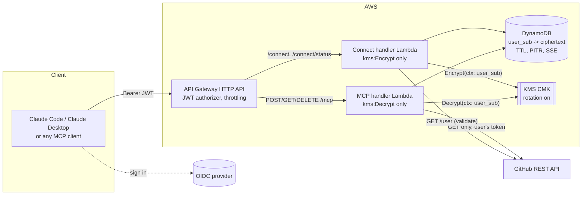
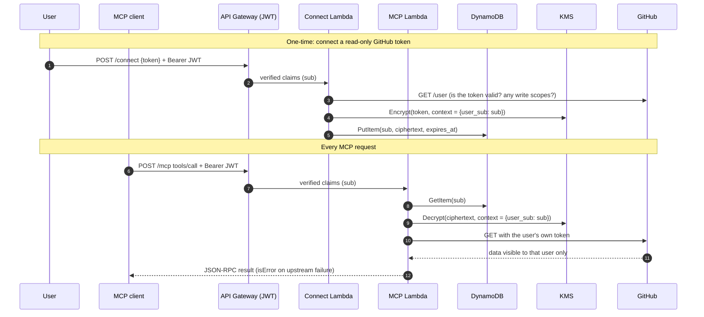

# mcp-gateway-aws

A serverless, multi-user [Model Context Protocol](https://modelcontextprotocol.io) server on AWS. Each user gets read-only access to an upstream API **with their own credential**, never a shared service token. GitHub is the example upstream.

- **Auth:** API Gateway HTTP API with a JWT authorizer. Any OIDC provider works (Okta, Auth0, Cognito, Entra ID).
- **Credentials:** each user's GitHub token is envelope-encrypted with a customer-managed KMS key and bound to that user through the KMS encryption context.
- **Protocol:** MCP Streamable HTTP in stateless JSON mode, implemented by hand over JSON-RPC 2.0 with no SDK dependency.
- **Infra:** one TypeScript CDK stack. Least-privilege IAM is enforced by tests.

54 tests (45 pytest, 9 CDK assertions). No runtime dependencies beyond the Python standard library and the boto3 that ships with Lambda.

## Why per-user credentials

The quick way to put an internal API behind an AI assistant is a single service token on the server. That works for a demo and breaks down in production:

| Shared service token | Per-user credential (this repo) |
|---|---|
| Everyone sees whatever the service account can see | Users see exactly what their own account can see |
| Audit logs show one identity for all activity | Upstream audit logs show the real user |
| One leaked token exposes everything | A leaked row is useless without KMS and the matching user context |
| Off-boarding means rotating a token everyone uses | Delete one row, or let it expire |
| Rate limits are shared by all users | Rate limits are per user |

## Architecture



### Request flow



## Tools

All tools are annotated `readOnlyHint: true`, and the GitHub client can only send `GET` requests.

| Tool | What it does |
|---|---|
| `list_repos` | Repositories the user can access, most recently updated first |
| `get_file` | Read a text file (up to 200 KB) or list a directory |
| `search_issues` | GitHub issue and PR search, e.g. `repo:octo/app is:open label:bug` |
| `list_pull_requests` | Pull requests in a repository, by state |

Each tool's JSON Schema is advertised in `tools/list` and enforced before any upstream call, so bad arguments never reach GitHub.

## Deploy

Prerequisites: Node 20+, Python 3.12, AWS CDK v2, an AWS account you control, and an OIDC provider that issues access tokens for an API audience.

```bash
cd cdk
npm ci
npx cdk bootstrap   # once per account and region
npx cdk deploy \
  -c oidcIssuer=https://idp.example.com/oauth2/default \
  -c oidcAudience=api://mcp-gateway \
  -c tokenTtlDays=90
```

Outputs include `McpUrl` and `ConnectUrl`.

### Connect your GitHub token

Create a [fine-grained personal access token](https://github.com/settings/personal-access-tokens/new) with read-only repository permissions (Contents, Issues, Pull requests, Metadata). Then, with an access token from your IdP in `$JWT`:

```bash
curl -X POST "$CONNECT_URL" \
  -H "Authorization: Bearer $JWT" \
  -H "Content-Type: application/json" \
  -d '{"token": "github_pat_..."}'

curl "$CONNECT_URL/status" -H "Authorization: Bearer $JWT"
curl -X DELETE "$CONNECT_URL" -H "Authorization: Bearer $JWT"   # revoke
```

Classic tokens with write scopes (`repo`, `workflow`, `write:*`, `admin:*`, ...) are rejected.

## Use it from an MCP client

**Claude Code**

```bash
claude mcp add --transport http github-gateway "$MCP_URL" \
  --header "Authorization: Bearer $JWT"
```

Or check a project-scoped `.mcp.json` into a repo, so the token comes from each developer's environment:

```json
{
  "mcpServers": {
    "github-gateway": {
      "type": "http",
      "url": "https://abc123.execute-api.us-east-1.amazonaws.com/mcp",
      "headers": { "Authorization": "Bearer ${MCP_GATEWAY_JWT}" }
    }
  }
}
```

**Claude Desktop** (through the `mcp-remote` bridge), in `claude_desktop_config.json`:

```json
{
  "mcpServers": {
    "github-gateway": {
      "command": "npx",
      "args": [
        "mcp-remote",
        "https://abc123.execute-api.us-east-1.amazonaws.com/mcp",
        "--header",
        "Authorization:${AUTH_HEADER}"
      ],
      "env": { "AUTH_HEADER": "Bearer <your access token>" }
    }
  }
}
```

## Security model

| Threat | Control |
|---|---|
| Unauthenticated access | JWT authorizer on every route (asserted in CDK tests); handlers also fail closed if claims are missing |
| One user reading another user's token | Ciphertext is bound to `{user_sub}` via KMS encryption context; a row copied to another key will not decrypt (unit tested) |
| Over-broad Lambda permissions | MCP Lambda: `kms:Decrypt` + `dynamodb:GetItem` only. Connect Lambda: `kms:Encrypt` + Get/Put/Delete only. Both KMS grants require the encryption context key. No wildcard actions (tested) |
| Tokens leaking into logs | Tokens and request bodies are never logged; user IDs are logged as a truncated SHA-256; `GitHubClient.__repr__` masks the token; tests assert neither token nor raw `sub` appears in logs |
| Write access through the gateway | Client issues GET only; tools are read-only; classic tokens with write scopes are rejected at connect time |
| Stale credentials | DynamoDB TTL plus an application-side expiry check (TTL deletion is lazy) |
| Abuse and runaway agents | Stage throttling (20 rps, burst 40); upstream rate limits are per user |
| Data loss | PITR on the table, key and table retained on stack deletion, KMS rotation on |
| Path traversal and injection in tool args | Schema validation with patterns for owner and repo; `.` and `..` path segments rejected; paths URL-encoded |

## Design decisions

- **Stateless Streamable HTTP, no SSE.** Lambda has no long-lived connections, and tools-only servers do not need server-initiated messages. Each POST returns one JSON response, notifications return `202`, and `GET /mcp` returns `405` as the spec allows.
- **Hand-rolled JSON-RPC.** The protocol surface for a tools server is small. Writing it directly keeps the deployment package tiny, cold starts fast, and the error mapping explicit: protocol errors are JSON-RPC errors, while tool failures are `isError` results the model can read and recover from.
- **Lazy credential access.** `initialize`, `ping`, and `tools/list` never touch DynamoDB or KMS. The token is decrypted only for `tools/call`, once per request, and never cached across invocations.
- **Two encryption layers, two purposes.** The table uses AWS-managed encryption at rest. The token itself is envelope-encrypted with a separate CMK so that only the two Lambdas, under narrow conditions, can ever see plaintext. Using the CMK for the table too would force broad decrypt grants on it.
- **Separate Lambdas for read and write paths.** The function that serves model traffic cannot write credentials, and the function that writes credentials cannot decrypt them.

## Testing

```bash
python -m venv .venv && . .venv/bin/activate
pip install -r requirements-dev.txt
pytest                      # 45 tests: protocol, tools, connect flow, token store

cd cdk && npm ci && npm test   # 9 CDK assertion tests: encryption, auth, IAM
```

The Python tests use in-memory fakes for KMS (including encryption-context enforcement), DynamoDB, and the GitHub HTTP API, so they run offline in well under a second.

## Roadmap

- Implement the MCP authorization spec (OAuth 2.0 protected resource metadata) so clients can sign in through the browser instead of pasting a JWT.
- GitHub App user-to-server tokens instead of personal access tokens.
- Pluggable upstreams behind the same connect and tool interfaces.
- WAF and per-user quotas in DynamoDB.

## License

MIT
